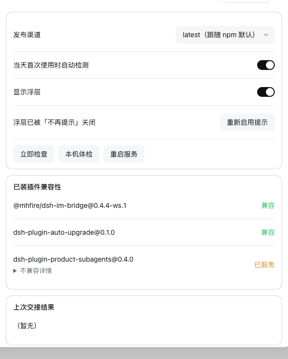
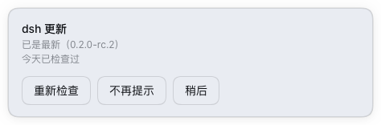

# self-dsh-plugins

自研 / 自维护 / fork 来的 [DeepSeek Harness](https://github.com/deepseek-ai)（`dsh`）插件集合。
每个子目录是一个独立插件，通过 profile 的 `link:` 依赖挂到本机 DSH 上使用；**不走 npm 发布流程**。

## 插件清单

| 目录 | 包名 | 作用 | 状态 |
|---|---|---|---|
| [`dsh-auto-upgrade/`](./dsh-auto-upgrade) | `dsh-plugin-auto-upgrade` | dsh Web UI 自升级：检测 → 兼容性预检 → 非阻塞浮层 → 一键备份 / 安装 / 校验 / 重启 | 可用（真机升级链路待验证） |
| [`dsh-awake/`](./dsh-awake) | `dsh-plugin-awake` | 发送栏咖啡杯按钮：点一下由宿主拉起 `caffeinate -i` 保持唤醒，再点一下停；只有按钮，开/关靠图标颜色区分 | 可用（门禁全绿；真机点击未验收） |
| [`dsh-external-discuss/`](./dsh-external-discuss) | `dsh-plugin-external-discuss` | 把 DSH 会话一键送到外部模型（清言网页版）继续讨论 | 可用（需配套 Chrome 扩展；仅清言接通） |
| [`dsh-im-bridge-workspaces/`](./dsh-im-bridge-workspaces) | `@mhfire/dsh-im-bridge` | 企业微信智能机器人 ⇄ DSH Agent 桥接，本地 fork 增加多工作区 `/ws` 切换 | 可用（本机已接入 profile） |
| [`dsh-plugin-product-subagents/`](./dsh-plugin-product-subagents) | `dsh-plugin-product-subagents` | 把 Claude Code / Codex / 任意 ACP CLI 变成基于角色的 subagent（`0.2.0` 线可续接；`0.2.1+` 外部子代理为一次性） | 可用（DSH `0.2.0-rc.2` / `0.2.1-alpha.5` / `0.2.1-rc.1` 均通过一次性 profile 验收） |
| [`dsh-prompt-optimizer/`](./dsh-prompt-optimizer) | `@y1x1n/dsh-prompt-optimizer` | 发送栏纯图标按钮：一键优化提示词，完成后直接写回输入框（fork：线性图标 / 去文案 / 内联 loading，无弹出面板） | 可用（`0.6.1-fork.1`，门禁全绿；真机 GUI 手点未做） |

---

## dsh-auto-upgrade

**来源：纯原创**（`package.json` 的 `repository` 已指向本仓库 `directory: dsh-auto-upgrade`）。
**改动：—**（没有上游）。

给 dsh 的 Web UI 加一个**自升级**入口：当天首次打开页面时自动检测 dsh 新版本与已装插件的兼容性，
用一个**不打断当前工作**的浮层提示；用户点「升级」后才走完整链路。





### 它做什么

1. **当天首次打开自动检测**：宿主按本地日期幂等，同一天多标签页 / 刷新只真正检测一次。
2. **检测两件事**：npm 上的 dsh 新版本；已装插件对**目标版本**的兼容性（用官方 `evaluatePluginCompatibility`，不是自己写范围匹配）。
3. **不打断工作的浮层**：右下角卡片，只占自己的位置；可「稍后」「不再提示」。
4. **点升级才动手**：会话门禁 → 插件门禁 → 备份 `~/.dsh` → 停服 → `npm install -g` → 对版 + 组合冒烟 → 重启交接。
5. **回滚与重启**：重装指定旧版本；或只重启服务。设置页还有本机体检、插件兼容表、升级 / 重启日志。

### 关键设计

- **双面插件，无构建步骤**：宿主半边 `lib/index.js` 用 cordis 注册 `/api/dsh-auto-upgrade/*` 路由族；
  浏览器半边 `lib/client.js` 手写并包在 `window.__ModuleLoader__.load({id, factory})` 里，注册
  `shell.overlay` 浮层与 `settings.section` 设置页。
- **变更必须脱离进程**：`npm install -g` 覆盖的正是宿主此刻在运行的那棵树，而「停服」就是杀掉宿主自己。
  所以宿主只做「门禁 → 备份 → 落 payload → fork detached helper → `exit 0`」，停服 / 安装 / 对版 / 冒烟 / 拉起
  都在生成的 POSIX sh helper 里。
- **故意不声明 `@deepseek-ai/dsh*` peerDependencies**：否则升级之后，平台闸门会把「负责升级 dsh 的插件」
  自己判成不兼容（自锁）。本包只声明 `react`（浏览器半边需要）。
- **安全边界**：路由族能读 npm、重写全局安装树、覆盖 `~/.dsh`、结束本进程，所以一律 loopback-only
  （以 socket 地址为准，不信任 `X-Forwarded-For`），并且**有副作用的一律 POST**。
- **UI 吃 dsh 的设计 token**：字体 `--dsw-font-*`、圆角 `--dsw-radius-*`、语义色 `--dsw-alias-state-*`，
  数值逐条对齐官方实现。详见包内 README 的「UI 风格契约」。

### 两条门禁（默认策略）

| 情况 | 行为 |
|---|---|
| 有会话正在执行 | `409`，前端弹警告；用户确认后可带 `force` 继续（**仅警告**） |
| 目标版本与已装插件不兼容 | `409`，**拒绝升级且不可绕过**——先升级 / 移除那个插件，或为它写精确版本豁免 |

> 豁免是按「插件@版本 → dsh 版本」精确匹配的：为 `0.2.0-rc.2` 写的豁免，升级到别的版本时**自动失效**，
> 那个插件会立刻出现在「不兼容」里。这正是本插件要提前告诉你的信息。

### 已知限制（诚实清单）

- **真机的安装 / 升级 / 重启链路尚未执行**（属于需要用户点头的闸门）；只读半边与门禁已在真机验证。
- 只支持 macOS / Linux：helper 是 POSIX sh 脚本。
- `POST /plugins/action`（写豁免 / 禁用插件）尚未接线，如实返回 `501`；`GET /notes` 已实现。
- 暂不做「静默自动升级」：`policy.mode` 只接受 `notify`。

### 文档

- [设计：接口清单 + 数据流图 + 拍板结论](./dsh-auto-upgrade/docs/design/dsh-auto-upgrade-T1.md)
- [验收报告：逐条证据 + 明确没验证什么](./dsh-auto-upgrade/docs/acceptance/dsh-auto-upgrade-acceptance.md)
- 面向 agent 的工作约定：[`docs/plugins/dsh-auto-upgrade.md`](./docs/plugins/dsh-auto-upgrade.md)

---

## dsh-external-discuss

**来源：纯原创**。**改动：—**（没有上游）。

在助手消息操作栏（复制 / 反馈 / 新对话分支 / 用量 / 时间那一条）多出一个图标按钮，点开弹层选择投递目标：

| 目标 | 状态 | 行为 |
| --- | --- | --- |
| 清言（`chatglm.cn`） | ✅ 可用 | 在已登录的清言页新建对话 → 按 DSH 会话标题重命名 → 粘贴正文 → 发送 |
| 千问 / DeepSeek | ⏸ 占位 | 显示「即将支持」，不可点 |

链路：页面按钮 → `GET /api/dsh-external-discuss/payload?sessionId=…`（宿主取正文与标题，
取自 `session.deriveMessages()` 的会话投影，不是抓页面 DOM）→ `window.postMessage` →
配套 Chrome 扩展转发到清言标签页 → 回执逐级回投 → 按钮下方显示结果。

安装分两步：插件（`dsh plugin --profile web add`，装完重启 dsh web）+ Chrome 扩展
（`chrome://extensions` → 开发者模式 → 加载已解压的扩展程序 → 选 `extension/`，装完**刷新 DSH 页面**）。
清言是第三方页面，改版会让选择器失效——候选文本集中在 `extension/qingyan-content.js` 顶部的 `CONFIG` 里。
详见 [包内 README](./dsh-external-discuss/README.md) 与 [`docs/plugins/dsh-external-discuss.md`](./docs/plugins/dsh-external-discuss.md)。

---

## dsh-im-bridge-workspaces

**来源：fork** 自 npm 包 `@mhfire/dsh-im-bridge@0.4.4`（本地 fork 版本 `0.4.4-ws.3`），
上游原版说明见 [README.upstream.md](./dsh-im-bridge-workspaces/README.upstream.md)。

**改了什么：** 新增**工作区列表与 `/ws` 切换**（`/ws`、`/ws <序号|title|路径|id>`、`/ws reset`、
`/ws add <路径>`、`/ws help`，以及 `workspaceSwitch` / `workspaceAllowFrom` / `workspaceAdd` 三个配置项
与 `$DSH_HOME/dsh-im-bridge/workspace-bindings.json` 持久化）；**其余行为与上游一致**——按企微窗口建 Agent、
单聊一人一条、群聊共用一条、Settings 配置卡片、wecom-cli 办公层均未改。

包名与目录名不同（目录 `dsh-im-bridge-workspaces/` → 包名 `@mhfire/dsh-im-bridge`），fork 保持同名，
所以接入 profile 时 `bundle` 列表与 `cordis.patch.yml` 都不用改。
这是本仓库**唯一需要构建**的插件（`src/` → `lib/`，`pnpm run build`）。
详见 [包内 README](./dsh-im-bridge-workspaces/README.md) 与
[`docs/plugins/dsh-im-bridge-workspaces.md`](./docs/plugins/dsh-im-bridge-workspaces.md)。

---

## dsh-plugin-product-subagents

**来源：fork** 自 GitHub `shaokeyibb/dsh-plugin-product-subagents` v0.4.0，
commit `e5a002db3b8d6df984fdb5e704e9321dca1723cd`，MIT。

**改了什么（适配 DSH `0.2.x`，业务代码未改）：**

- 扩展 `peerDependencies` / `dsh.compatibility.dsh` 的 DSH 版本范围，补 `dshReleases` verdict
  （`0.2.0-rc.2`、`0.2.1-rc.1`，**均有一次性 profile 验收背书**：install · compose · start · uninstall）；
- 版本 `0.4.0 → 0.4.1`，同步 `CHANGELOG.md` / `docs/COMPATIBILITY.md` / `README.md` + `README.zh.md`；
- 并入本仓库统一管理（**已删除其内层 `.git`**，上游历史见上述 commit）。

> 为什么只改声明：0.4.0 在 `0.2.x` 上其实已能正常运行，缺的只是声明——
> DSH 启动时按插件**自己声明的** peer 范围判兼容，没覆盖就跳过该 bundle（表现为「插件莫名其妙没加载」）。
> ⚠️ prerelease 陷阱：`^0.2.0-rc.2` **不覆盖** `0.2.1-rc.1`，每条 `0.2.x` 线都要单独写一个锚点。

它把 Claude Code / Codex / 任意 ACP CLI 变成基于角色的可续接 subagent：一次性同步或异步可续接、
持久会话恢复、每角色 product 权限、受**权限天花板**约束的委派、声明式角色库（`roles/*.json`）。
详见 [英文 README](./dsh-plugin-product-subagents/README.md) / [中文 README](./dsh-plugin-product-subagents/README.zh.md) /
[`docs/plugins/dsh-plugin-product-subagents.md`](./docs/plugins/dsh-plugin-product-subagents.md)。

---

## 环境要求

| 项 | 要求 |
|---|---|
| DSH | `0.2.0-rc.2`（本机实测版本）；插件各自声明兼容范围，见上 |
| Node | `v24.21.0`（各插件 `engines` 不一，`dsh-auto-upgrade` / `dsh-external-discuss` 要求 `^22.19.0 \|\| >=24.0.0`，`dsh-plugin-product-subagents` 要求 `>=18`） |
| 包管理器 | **pnpm**（本仓库与全局约定一律 pnpm，禁 npm / yarn / bun / npx；详见 [`AGENTS.md`](./AGENTS.md) 强制规定 2） |
| 产品 CLI | `dsh-plugin-product-subagents` 至少需要 `claude` / `codex` / 任一 ACP CLI 之一（如本机的 `opencode`） |
| shell | macOS 自带 bash 3.2（脚本已按 3.2 写） |

## 安装 / 卸载

```sh
# 安装（<目录> 用仓库内的目录名，路径按实际 clone 位置调整）
dsh plugin --profile web add /Users/gubin/workspace/self-dsh-plugins/<目录>

# 卸载
dsh plugin --profile web remove <包名>
```

- `add` 时若插件 `package.json` 声明了 `dsh.bundle.patch`，会自动挂上 patch 层，**无需手改**
  `~/.dsh/profiles/web/cordis.patch.yml`。
- 本机 profile 是 `patchReload: live`：装完 / 改完通常**不用重启**，刷新页面即可。
  （`dsh-external-discuss` 与 `dsh-im-bridge-workspaces` 的宿主半边在冷启动装配，按各自 README 的说明处理。）
- `dsh plugin` 的 profile 目录在 `~/.dsh/profiles/web`；`dependencies` 用 `link:` 指向本仓库子目录。
- ⚠️ **改了 `link:` 目标路径后，必须在 `~/.dsh/profiles/web` 跑一次 `pnpm install`**，否则软链悬空、
  插件加载失败。

## 验证

```sh
# 跑 4 个插件的测试 / check / typecheck（缺 node_modules 的插件会明确跳过，不算失败）
scripts/pipeline/check-all.sh
scripts/pipeline/check-all.sh dsh-auto-upgrade dsh-plugin-product-subagents   # 只跑指定插件

# 在一次性 $DSH_HOME 里验证插件能被 profile 正确安装 + 组合（绝不触碰真实 ~/.dsh）
scripts/pipeline/install-check.sh
scripts/pipeline/install-check.sh dsh-plugin-product-subagents
```

- **本仓库的「交付物」不是线上服务，而是「插件被本机 DSH profile 正确装配」**——对应 `install-check.sh`，
  它每个插件新建一个 `mktemp -d` 的 `DSH_HOME`，`pnpm dlx @deepseek-ai/dsh@<当前版本> plugin --profile headless add <插件>`
  后用 `--dump-config` 校验，装完即删。
- `dsh-im-bridge-workspaces` 的 peer 声明已按实测收窄为 `^0.2.1-rc.2 || ^0.2.1-rc.4`（rc.2 / rc.4 均验过，
  [issue #3](https://github.com/guraul/self-dsh-plugins/issues/3) 已修），干净 checkout 可直接 `pnpm install`；
  `0.2.2-alpha.2` **未放宽**（`dsh-agent` 的 `installModelSelection` 签名变更，见
  [docs/COMPATIBILITY.md](./docs/COMPATIBILITY.md)）。
  它的构建产物**不可复现**（tsdown 把绝对路径与 CSS module 哈希写进产物），所以 CI 只跳过这一项的新鲜度检查，
  安装 / 测试 / typecheck / 语法门禁照跑；完整装配校验仍走 `scripts/pipeline/install-check.sh dsh-im-bridge-workspaces`。
- 只读状态一览：`scripts/pipeline/status.sh`。
- CI（`.github/workflows/ci.yml`）只跑测试 + `node --check`，**零部署步骤**。

## 开发流程

每个任务走 issue → worktree → PR → review → squash 合并（**没有部署**）：

```sh
scripts/pipeline/new-task.sh <issue号>          # 建分支 task/<号>-<slug> + worktree
cd .worktrees/<号>-<slug>                       # 在 worktree 里开发
scripts/pipeline/check-all.sh                   # 本地自测
scripts/pipeline/open-pr.sh                     # 自动推送 + 开 PR
# 拿到用户对 review 的明确同意后：
scripts/pipeline/merge-pr.sh
```

完整手册见 [`docs/pipeline/README.md`](./docs/pipeline/README.md)（进度台账：
[`docs/pipeline/PROGRESS.md`](./docs/pipeline/PROGRESS.md)）；给 agent 的强制规定见 [`AGENTS.md`](./AGENTS.md)，
插件级说明见 [`docs/plugins/`](./docs/plugins/README.md)。

## License

各插件来源不同：

- **原创插件**（`dsh-auto-upgrade`、`dsh-external-discuss`）为 MIT。
- **fork 来的插件**，授权按其各自上游：`dsh-plugin-product-subagents/` 内含上游的 MIT
  [`LICENSE`](./dsh-plugin-product-subagents/LICENSE)；`dsh-im-bridge-workspaces/` 为 MIT，
  上游授权见其 `package.json` 的 `license` 字段与上游仓库。

第三方来源的授权一律见**各自目录内**的 `LICENSE`。
